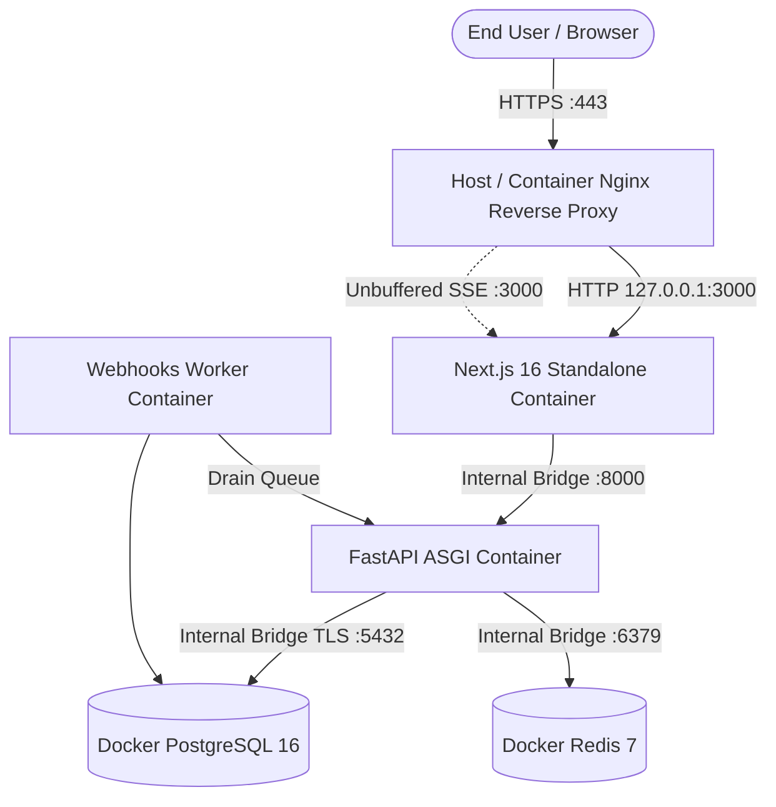

# Enterprise Production & Development Deployment Guide

This guide provides complete, beginner-friendly, production-hardened instructions for deploying, updating, and testing the LMS application across four critical scenarios:

1. [Scenario A: Fresh Deployment on a New Ubuntu Server](#scenario-a-fresh-deployment-on-a-clean-ubuntu-server)
2. [Scenario B: Replacing an Existing Production LMS (Host Nginx, Existing SSL, OS PostgreSQL/Redis)](#scenario-b-replacing-an-existing-lms-deployment)
3. [Scenario C: Applying Updates & Changes in Production (Zero-Downtime Update Runbook)](#scenario-c-applying-updates--code-changes-in-production)
4. [Scenario D: Testing Locally on Windows 11 with Docker](#scenario-d-testing-locally-on-windows-11-with-docker)
5. [Addressing Existing OS-Level PostgreSQL & Redis (Port Conflict Analysis)](#addressing-existing-os-level-postgresql--redis)
6. [Automated Backups & Disaster Recovery](#automated-backups--disaster-recovery)
7. [Troubleshooting Guide](#troubleshooting-guide)

---

## Architecture Overview



---

## Addressing Existing OS-Level PostgreSQL & Redis

### Will host-level PostgreSQL (5432) and Redis (6379) conflict with Docker?

> [!NOTE]
> **NO, THERE IS NO CONFLICT BY DEFAULT.**
> In our production [`docker-compose.yml`](docker-compose.yml), the `postgres` and `redis` services join the isolated internal Docker bridge network (`lms-network`) and **do NOT publish ports `5432` or `6379` to the host OS**.
> - The host's PostgreSQL continues listening on `127.0.0.1:5432` or `0.0.0.0:5432`.
> - Docker's PostgreSQL listens on internal container IP `postgres:5432`.
> They operate in completely separate network namespaces and do not collide.

### Recommended Choices for Host PostgreSQL & Redis:

1. **Option 1 (Recommended — Cleanest Isolation)**:
   Use Docker's isolated PostgreSQL and Redis containers. If the old OS-level services are no longer needed by any other application on the server, stop and disable them to free up server RAM:
   ```bash
   sudo systemctl stop postgresql redis-server
   sudo systemctl disable postgresql redis-server
   ```
2. **Option 2 (Migrating existing data from host PostgreSQL to Docker PostgreSQL)**:
   If the old LMS had data in the host PostgreSQL that you need:
   ```bash
   # Export from host PostgreSQL
   pg_dump -U postgres -d old_lms_db | gzip > old_lms_backup.sql.gz

   # Import into Docker PostgreSQL container
   gunzip -c old_lms_backup.sql.gz | docker compose exec -T postgres psql -U lms_migrator -d lms_db
   ```

---

## Scenario A: Fresh Deployment on a Clean Ubuntu Server

Use this scenario when setting up a brand-new VPS from scratch.

### Step A.1 — Server Preparation & Firewall
```bash
# Update and install dependencies
sudo apt update && sudo apt upgrade -y
sudo timedatectl set-timezone UTC
sudo apt install -y curl wget git ufw fail2ban jq htop ca-certificates gnupg lsb-release

# Configure firewall
sudo ufw default deny incoming
sudo ufw default allow outgoing
sudo ufw allow OpenSSH
sudo ufw allow 80/tcp
sudo ufw allow 443/tcp
sudo ufw --force enable
```

### Step A.2 — Install Docker Engine & Compose v2
```bash
sudo install -m 0755 -d /etc/apt/keyrings
curl -fsSL https://download.docker.com/linux/ubuntu/gpg | sudo gpg --dearmor -o /etc/apt/keyrings/docker.gpg
sudo chmod a+r /etc/apt/keyrings/docker.gpg

echo \
  "deb [arch=$(dpkg --print-architecture) signed-by=/etc/apt/keyrings/docker.gpg] https://download.docker.com/linux/ubuntu \
  $(lsb_release -cs) stable" | sudo tee /etc/apt/sources.list.d/docker.list > /dev/null

sudo apt update
sudo apt install -y docker-ce docker-ce-cli containerd.io docker-buildx-plugin docker-compose-plugin
sudo usermod -aG docker $USER
newgrp docker
```

### Step A.3 — Clone & Generate Secrets
```bash
sudo mkdir -p /opt/lms && sudo chown -R $USER:$USER /opt/lms
git clone <YOUR_GIT_REPO_URL> /opt/lms
cd /opt/lms

chmod +x scripts/*.sh
./scripts/generate-keys.sh yourdomain.com
```
*(Copy and store the printed **Initial Super Admin Password**)*.

### Step A.4 — Database Setup & Seeding
```bash
# 1. Start database and cache
docker compose up -d postgres redis

# 2. Run all 57 database schema migrations
docker compose run --rm backend alembic upgrade head

# 3. Seed catalogs and create initial Super Admin
docker compose run --rm backend python -m backend.cli.seed \
  --admin-username superadmin \
  --admin-email admin@yourdomain.com \
  --non-interactive

# 4. (Optional) Run initial data synchronisation from external LAIT API
docker compose run --rm backend python -m backend.cli.sync_all --once
```

After every `alembic upgrade head` that adds a table, refresh the AI assistant's
read-only database role so the new table's grants are decided deliberately
(new tables are invisible to it until this runs):

```bash
docker compose run --rm backend python -m backend.cli.create_ai_readonly_role
```

### Step A.5 — Issue Let's Encrypt SSL & Launch Stack
```bash
# 1. Bootstrap temporary HTTP config
cp nginx/conf.d/http-bootstrap.conf.example nginx/conf.d/default.conf
docker compose --profile docker-nginx up -d nginx

# 2. Issue certificate
docker compose --profile docker-nginx run --rm certbot certonly \
  --webroot --webroot-path=/var/www/certbot \
  --email admin@yourdomain.com --agree-tos --no-eff-email -d yourdomain.com

# 3. Link certificates and restore production HTTPS config
docker compose --profile docker-nginx exec -T certbot sh -c "
  mkdir -p /etc/letsencrypt/live/app &&
  cp -L /etc/letsencrypt/live/yourdomain.com/fullchain.pem /etc/letsencrypt/live/app/fullchain.pem &&
  cp -L /etc/letsencrypt/live/yourdomain.com/privkey.pem /etc/letsencrypt/live/app/privkey.pem
"
git checkout nginx/conf.d/default.conf
docker compose --profile docker-nginx exec nginx nginx -s reload

# 4. Launch full stack
docker compose --profile docker-nginx up -d
```

---

## Scenario B: Replacing an Existing LMS Deployment

*(e.g., Server `root@vmi3043660`, domain `https://lait.co` -> `https://www.lait.co`, existing host Nginx, existing Certbot certs at `/etc/letsencrypt/live/lait.co/`, host PostgreSQL & Redis)*.

### Step B.1 — Backup & Stop the Old Application
```bash
# 1. Backup old project directory
sudo cp -r /var/www/lait/LMS /var/www/lait/LMS_backup_$(date +%F_%T)

# 2. Stop and disable old Gunicorn/systemd service
sudo systemctl stop lms 2>/dev/null || sudo systemctl stop gunicorn 2>/dev/null
sudo systemctl disable lms 2>/dev/null || sudo systemctl disable gunicorn 2>/dev/null
```

### Step B.2 — Replace Codebase in `/var/www/lait/LMS`
```bash
sudo mv /var/www/lait/LMS /var/www/lait/LMS_old
sudo git clone <YOUR_GIT_REPO_URL> /var/www/lait/LMS
cd /var/www/lait/LMS
```

### Step B.3 — Generate Secrets & Configure Environment
```bash
chmod +x scripts/*.sh
./scripts/generate-keys.sh www.lait.co
```
*(Store the printed **Super Admin Password**)*.

Make sure `.env.production` allows both `lait.co` and `www.lait.co`:
```ini
API_CORS_ORIGINS=https://www.lait.co,https://lait.co
API_TRUSTED_HOSTS=www.lait.co,lait.co,backend,127.0.0.1
SERVER_FORWARDED_ALLOW_IPS=127.0.0.1,172.16.0.0/12,10.0.0.0/8
```

### Step B.4 — Initialize Database & Seed
```bash
# 1. Start Docker PostgreSQL & Redis
docker compose up -d postgres redis

# 2. Run migrations
docker compose run --rm backend alembic upgrade head

# 3. Seed initial Super Admin and catalogs
docker compose run --rm backend python -m backend.cli.seed \
  --admin-username superadmin \
  --admin-email admin@lait.co \
  --non-interactive

# 4. Run initial data synchronisation from external LAIT API (imports users, courses, batches)
docker compose run --rm backend python -m backend.cli.sync_all --once
```

### Step B.5 — Start Application Containers
```bash
# Start backend, webhooks-worker, and frontend (frontend binds to 127.0.0.1:3000)
docker compose up -d backend webhooks-worker frontend
```

### Step B.6 — Update Host Nginx Configuration
Edit `/etc/nginx/sites-available/lms`:
```nginx
# 1️⃣ Redirect non-www HTTP → www HTTPS
server {
    listen 80;
    server_name lait.co;
    return 301 https://www.lait.co$request_uri;
}

# 2️⃣ Redirect non-www HTTPS → www HTTPS
server {
    listen 443 ssl;
    server_name lait.co;
    ssl_certificate /etc/letsencrypt/live/lait.co/fullchain.pem;
    ssl_certificate_key /etc/letsencrypt/live/lait.co/privkey.pem;
    return 301 https://www.lait.co$request_uri;
}

# 3️⃣ Redirect HTTP www → HTTPS www
server {
    listen 80;
    server_name www.lait.co;
    return 301 https://www.lait.co$request_uri;
}

# 4️⃣ Main HTTPS www server
server {
    listen 443 ssl http2;
    server_name www.lait.co;

    ssl_certificate /etc/letsencrypt/live/lait.co/fullchain.pem;
    ssl_certificate_key /etc/letsencrypt/live/lait.co/privkey.pem;

    ssl_protocols TLSv1.2 TLSv1.3;
    ssl_ciphers ECDHE-ECDSA-AES128-GCM-SHA256:ECDHE-RSA-AES128-GCM-SHA256:ECDHE-ECDSA-AES256-GCM-SHA384:ECDHE-RSA-AES256-GCM-SHA384;
    ssl_prefer_server_ciphers off;
    ssl_session_cache shared:SSL:10m;
    ssl_session_timeout 1d;

    add_header X-Frame-Options "SAMEORIGIN" always;
    add_header X-Content-Type-Options "nosniff" always;
    add_header X-XSS-Protection "1; mode=block" always;
    add_header Referrer-Policy "strict-origin-when-cross-origin" always;
    add_header Strict-Transport-Security "max-age=31536000; includeSubDomains; preload" always;

    client_max_body_size 100M;

    # Realtime SSE Streaming
    location ~ ^/api/(backend/)?realtime/ {
        proxy_pass http://127.0.0.1:3000;
        proxy_http_version 1.1;
        proxy_set_header Connection "";
        proxy_set_header Host $host;
        proxy_set_header X-Real-IP $remote_addr;
        proxy_set_header X-Forwarded-For $proxy_add_x_forwarded_for;
        proxy_set_header X-Forwarded-Proto $scheme;
        proxy_set_header X-Forwarded-Host $host;
        proxy_buffering off;
        proxy_cache off;
        proxy_read_timeout 3600s;
        proxy_send_timeout 3600s;
        chunked_transfer_encoding off;
    }

    # Next.js Static Cache
    location /_next/static/ {
        proxy_pass http://127.0.0.1:3000;
        proxy_http_version 1.1;
        proxy_set_header Host $host;
        expires 365d;
        add_header Cache-Control "public, max-age=31536000, immutable";
    }

    # Main Application Proxy
    location / {
        proxy_pass http://127.0.0.1:3000;
        proxy_http_version 1.1;
        proxy_set_header Upgrade $http_upgrade;
        proxy_set_header Connection "upgrade";
        proxy_set_header Host $host;
        proxy_set_header X-Real-IP $remote_addr;
        proxy_set_header X-Forwarded-For $proxy_add_x_forwarded_for;
        proxy_set_header X-Forwarded-Proto $scheme;
        proxy_set_header X-Forwarded-Host $host;
        proxy_read_timeout 120s;
    }
}
```

Reload Nginx:
```bash
sudo nginx -t && sudo systemctl reload nginx
```

---

## Audit Log: Client IP Address & Location

The audit trail records each user's public IP address and an IP-estimated
location. Both depend on deployment configuration; without it the addresses
are recorded as *unknown* (never as the server's own address).

**How the address travels:** browser -> host nginx (sets `X-Real-IP
$remote_addr`, which a client cannot override) -> console container -> API.

1. **Console** (`frontend` service): `LMS_CLIENT_IP_HEADER=x-real-ip` (already
   in `docker-compose.yml`). Safe only while its port is bound to `127.0.0.1`,
   so nginx is the only way in. Do not set it on a console reachable directly.
2. **API** (`.env.production`): `SERVER_FORWARDED_ALLOW_IPS` must list the
   addresses the console reaches the API from -- the Docker network:
   `SERVER_FORWARDED_ALLOW_IPS=127.0.0.1,172.16.0.0/12`. Never `*`.
3. **nginx**: every `location` that proxies to the console must keep
   `proxy_set_header X-Real-IP $remote_addr;` (the configuration above does).
   If a CDN (e.g. Cloudflare) is ever put in front, nginx must first restore the
   real address with `set_real_ip_from` + `real_ip_header` for that CDN's
   ranges; otherwise every user is recorded at the CDN's address.

**Location database (MaxMind GeoLite2-City, free account required):**

```bash
# 1. Create a free MaxMind account and a licence key: https://www.maxmind.com/en/geolite2/signup
sudo apt install geoipupdate
sudo tee /etc/GeoIP.conf >/dev/null <<'EOF'
AccountID YOUR_ACCOUNT_ID
LicenseKey YOUR_LICENCE_KEY
EditionIDs GeoLite2-City
DatabaseDirectory /var/www/lait/LMS/var/geoip
EOF
sudo mkdir -p /var/www/lait/LMS/var/geoip
sudo geoipupdate -v
# 2. Keep it current (MaxMind publishes twice weekly; their licence requires
#    updates). The API notices the replaced file on its own -- no restart.
echo "17 3 * * 2,5 root /usr/bin/geoipupdate" | sudo tee /etc/cron.d/geoipupdate
```

The file is mounted read-only at `/app/var/geoip/GeoLite2-City.mmdb`
(`GEOIP_CITY_DB_PATH`). Without it, events are still written with location
status `UNAVAILABLE`. `GEOIP_ENABLED=false` turns lookups off. GeoLite2 data
is © MaxMind and requires attribution where it is shown.

Locations are estimates of where an IP address's network is, not where a
person is: VPNs, mobile carriers and shared office connections place users
elsewhere. Rows written before this release keep their original IP and have
no location (the audit table is append-only; nothing is backfilled).

---

## Scenario C: Applying Updates & Code Changes in Production

Whenever you make changes to the code, fix bugs, or push new features to your Git repository, follow this zero-downtime update sequence:

```bash
cd /opt/lms  # or /var/www/lait/LMS

# 1. Pull the latest commits from your repository
git pull origin main

# 2. Build the updated Docker images in the background
docker compose build backend frontend

# 3. Apply any new database schema migrations safely
docker compose run --rm backend alembic upgrade head

# 4. Perform a rolling restart of the application services
# (PostgreSQL and Redis keep running without restart)
docker compose up -d --no-deps backend frontend webhooks-worker

# 5. Verify the services are healthy
docker compose ps
docker compose logs --tail=50 backend
docker compose logs --tail=50 frontend
```

> [!IMPORTANT]
> **Applying changes made to `.env`**:  
> `docker compose restart` does **not** re-read `.env` files. If you add, remove, or change any environment variables in `.env`, you must run:  
> ```bash
> docker compose up -d backend webhooks-worker
> ```  
> to recreate the containers with the updated environment.

### Emergency Rollback Runbook (If an Update Has Issues)
```bash
# 1. Check out the previous stable commit or release tag
git checkout <PREVIOUS_COMMIT_HASH>

# 2. Rebuild and restart
docker compose build backend frontend
docker compose up -d --no-deps backend frontend webhooks-worker

# 3. If a database rollback is required:
./scripts/restore-db.sh ./backups/PRE_DEPLOYMENT_BACKUP.sql.gz
```

---

## Scenario D: Testing Locally on Windows 11 with Docker

You can test the exact containerized application locally on your Windows 11 development machine using Docker Desktop before deploying to production.

We have created [`docker-compose.local.yml`](docker-compose.local.yml) specifically for local Windows testing. It:
- Mapped PostgreSQL to port `5433` (to avoid conflicting if you have PostgreSQL on Windows port `5432`).
- Runs in development mode (`APP_ENVIRONMENT=development`).
- Requires no SSL certificates or Nginx reverse proxy.

### Step D.1 — Start the Local Docker Stack
Open PowerShell in your project root:
```powershell
docker compose -f docker-compose.local.yml up --build -d
```

### Step D.2 — Run Database Migrations Locally
```powershell
docker compose -f docker-compose.local.yml run --rm backend alembic upgrade head
```

### Step D.3 — Seed Initial Local Super Admin
```powershell
docker compose -f docker-compose.local.yml run --rm backend python -m backend.cli.seed `
  --admin-username superadmin `
  --admin-email admin@local.test `
  --non-interactive
```

### Step D.4 — Test in Your Browser
- **Frontend URL**: `http://localhost:3000/login`
- **Backend API**: `http://localhost:8000/api/v1`
- **Backend Liveness**: `http://localhost:8000/livez`
- **Initial Login**:
  - **Username**: `superadmin`
  - **Password**: `adminpassword123` *(configured in `docker-compose.local.yml`)*

### Step D.5 — Stopping the Local Stack
```powershell
docker compose -f docker-compose.local.yml down
```

---

## Automated Backups & Disaster Recovery

### Manual Backup
```bash
./scripts/backup-db.sh /var/www/lait/LMS/backups
```

### Schedule Daily Cron Backup (Runs at 02:00 UTC, keeps 14 days)
```bash
(crontab -l 2>/dev/null; echo "0 2 * * * /var/www/lait/LMS/scripts/backup-db.sh /var/www/lait/LMS/backups >> /var/log/lms-backup.log 2>&1") | crontab -
```

### Restore Database
```bash
./scripts/restore-db.sh /var/www/lait/LMS/backups/lms_db_YYYYMMDD_HHMMSSZ.sql.gz
```

---

## Troubleshooting Guide

### 1. `502 Bad Gateway` on Nginx
- **Cause**: The Next.js frontend or backend is starting up or crashed.
- **Check**:
  ```bash
  docker compose ps
  docker compose logs -f --tail=50 frontend backend
  ```

### 2. `Address already in use: 5432` or `Address already in use: 6379`
- **Cause**: A container was configured with `ports: 5432:5432` while the host has OS-level PostgreSQL.
- **Resolution**: Ensure `docker-compose.yml` does NOT have `ports: 5432:5432` for `postgres` or `6379:6379` for `redis`. In our updated configuration, they communicate exclusively across internal network `lms-network`.

### 3. Realtime Stream Disconnecting Frequently
- **Cause**: Nginx proxy buffering or caching is choking SSE frames.
- **Resolution**: Ensure `proxy_buffering off;` and `proxy_cache off;` are present in Nginx for `location ~ ^/api/(backend/)?realtime/`.

### 4. `USERS: LAIT synchronisation is not configured`
- **Cause**: `LAIT_API_KEY` is missing or empty in `/var/www/lait/LMS/.env`.
- **Resolution**:
  1. Add the credentials to `.env`:
     ```ini
     LAIT_API_BASE_URL=https://api.londonacademyofit.co.uk
     LAIT_API_KEY=leTk0x3uoi1sRhPQFNvX86bw9VWMqjtm
     ```
  2. Recreate the containers with the new variables:
     ```bash
     docker compose up -d backend webhooks-worker
     ```

### 5. `idle: automatic synchronisation is switched off` in Terminal
- **Cause**: Running `python -m backend.cli.sync_all` without arguments defaults to background daemon mode, which waits for the scheduled toggle in the dashboard.
- **Resolution**: Pass the `--once` flag to trigger an immediate, one-pass synchronization:
  ```bash
  docker compose run --rm backend python -m backend.cli.sync_all --once
  ```

### 6. `502 Bad Gateway` After Replacing Existing LMS
- **Cause**: The host's Nginx configuration (`/etc/nginx/sites-available/lms`) is still pointing to port `8000` (the old Gunicorn port) instead of the new Next.js frontend port `3000`.
- **Resolution**:
  1. Update `/etc/nginx/sites-available/lms`: change `proxy_pass http://127.0.0.1:8000;` to `proxy_pass http://127.0.0.1:3000;`.
  2. Reload Nginx: `sudo nginx -t && sudo systemctl reload nginx`.
